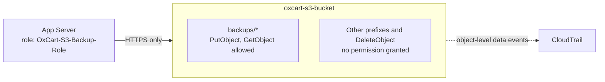

# Infrastructure and Storage Hardening

| | |
|---|---|
| **Scope** | Three EC2 instances (Bastion, App Server, Wazuh Server) and one S3 security-data bucket |
| **Region** | `ap-southeast-1` (Singapore) |
| **Goals** | Reduce host access, secure stored security data, apply least privilege, enable auditability |
| **Validation status** | Controls configured; validation partially complete (see [section 2](#2-control-summary-and-validation-status)) |
| **Related** | [Architecture](../README.md), [Suricata IDS](suricata-ids.md) |

---

## 1. Objective

Harden the OxCart AWS infrastructure by:

- Reducing unnecessary host access
- Securing stored security data
- Applying least-privilege permissions
- Enabling auditability

The work covers the three EC2 roles in the lab and an S3 bucket (`oxcart-s3-bucket`) used as a repository for security backups, configuration artifacts, and investigation data.

> **How to read this report:** a control is marked **Verified** only when there is observed evidence for it (a screenshot or recorded test output). **Configured** means it has been set up but its evidence has not yet been captured. **Pending** means the validation test has not yet been run. Pending items are listed openly rather than assumed to pass.

---

## 2. Control Summary and Validation Status

| Area | Control | Status | Evidence |
|---|---|---|---|
| EC2 | Instance inventory and health | Verified | `ec2-01-infrastructure-overview.png` |
| EC2 | SSH key authentication on, password authentication off (Bastion, App Server) | Verified | `ec2-02-ssh-hardening-*.png` |
| EC2 | Root SSH login: disabled on App Server; key-only on Bastion | Verified (see [finding F1](#5-findings-and-recommendations)) | `ec2-02-ssh-hardening-*.png` |
| EC2 | Bastion security group: SSH limited to one source IP, HTTP public | Verified (see [finding F2](#5-findings-and-recommendations) for broad rules) | `ec2-06-bastion-security-group.png` |
| EC2 | External scan shows only TCP 22 and 80 | Recorded; screenshot pending | `ec2-03-external-nmap.png` |
| EC2 | Suricata and Wazuh agent on Bastion | Verified in [Suricata report](suricata-ids.md) | `suricata-*.png` |
| S3 | Block Public Access enabled | Verified | `s3-02-public-access-controls.png` |
| S3 | HTTPS-only bucket policy | Verified | `s3-03-https-policy.png` |
| S3 | SSE-S3 encryption, versioning, bucket-owner-enforced ownership | Configured; evidence pending | `s3-01-encryption-versioning.png` |
| S3 | Least-privilege IAM role for the App Server | Configured; policy evidence pending | `s3-04-iam-least-privilege.png` |
| S3 | Allow/deny access tests | Pending | see [section 4.4](#44-access-control-validation) |
| S3 | CloudTrail object-level audit events | Trail created; event validation pending | `s3-05`, `s3-06` |

---

## 3. EC2 Hardening

### 3.1 Environment Overview

All three instances are running and passing their status checks in `ap-southeast-1a`:

| Instance | Role | Type |
|---|---|---|
| OxCart App Server | Application host (private subnet) | `t3.micro` |
| OxCart Bastion | Entry point, reverse proxy, NAT, Suricata sensor | `t3.small` |
| OxCart Central (Wazuh) | SIEM (private subnet) | `c7i-flex.large` |


### 3.2 SSH Configuration

The effective SSH daemon configuration was read on each host with `sshd -T`, which shows the settings in force rather than the contents of the config file:

```bash
sudo sshd -T | grep -E 'permitrootlogin|pubkeyauthentication|passwordauthentication'
```

| Setting | Bastion | App Server |
|---|---|---|
| `PermitRootLogin` | `prohibit-password` | `no` |
| `PubkeyAuthentication` | `yes` | `yes` |
| `PasswordAuthentication` | `no` | `no` |

**Bastion**


**App Server**


Password authentication is off on both hosts, which removes password guessing as an attack path. On the Bastion, `prohibit-password` still permits root login with an SSH key, so root login there is restricted rather than disabled (see [F1](#5-findings-and-recommendations)).

### 3.3 Bastion Host

The Bastion is the controlled entry point into the private environment and provides outbound NAT for private-subnet instances.

Hardening measures:

- Key-based SSH authentication enabled; password authentication disabled.
- Root SSH login restricted to key-only (`prohibit-password`).
- EC2 source/destination check disabled, as required for its NAT function.
- IP forwarding and outbound masquerading configured for private-subnet connectivity.
- Suricata deployed to inspect traffic and generate alerts.
- Wazuh agent forwarding Suricata events for centralized monitoring.

Suricata deployment, rules, and tests are documented in the [Suricata IDS report](suricata-ids.md). The Wazuh alert below shows Suricata events arriving from the Bastion's agent (`ip-10-0-2-242`):


### 3.4 Bastion Security Group

`OxCart-bastion-sg` limits the Bastion's public exposure to two services. SSH is restricted to a single administrator address (`/32`, redacted in the screenshot), and HTTP is open to the Internet because the Bastion is the public web entry point.


| # | Type | Port | Source | Note |
|---|---|---|---|---|
| 1 | All traffic | All | Another security group | Described as a ping test (see [F2](#5-findings-and-recommendations)) |
| 2 | SSH | 22 | Administrator `/32` | Single-address restriction |
| 3 | HTTP | 80 | `0.0.0.0/0` | Public web entry point |
| 4 | All traffic | All | Itself (`OxCart-bastion-sg`) | Internal traffic (see [F2](#5-findings-and-recommendations)) |

### 3.5 App Server

The App Server hosts OxCart in the private subnet and is not directly reachable from the Internet.

- SSH access controlled through the Bastion.
- Key-only SSH; root login disabled (`PermitRootLogin no`).
- Application served behind Nginx, with Flask bound to the loopback interface.
- An EC2 IAM role grants narrowly scoped S3 permissions for the backup workflow (see [section 4.3](#43-least-privilege-iam)).

### 3.6 Wazuh Server

The Wazuh server provides centralized security-event collection and investigation.

- Hosted in the private subnet.
- Administered through the Bastion.
- Dashboard reached through an SSH tunnel and never exposed publicly.
- Receives Suricata events forwarded by the Bastion's Wazuh agent.

### 3.7 External Exposure

An external Nmap service scan of the Bastion's public address (default top 1,000 TCP ports) reported:

| Port | State |
|---|---|
| TCP 22 | Open (SSH, restricted by security group source) |
| TCP 80 | Open (HTTP) |
| All other scanned ports | Not reported open |

This describes the observed scan only. It does not prove that every other port is closed, since the scan covers the top 1,000 TCP ports and no UDP or full-range testing. The SSH result should be read together with the source restriction shown in section 3.4.

---

## 4. S3 Security Hardening

### 4.1 Purpose

`oxcart-s3-bucket` is a controlled repository for OxCart security backups, configuration artifacts, and investigation data.



### 4.2 Storage Security Controls

| Control | Setting | Status |
|---|---|---|
| **Block Public Access** | All four settings enabled | Verified |
| **HTTPS enforcement** | Bucket policy denies requests without secure transport | Verified |
| **Object ownership** | Bucket owner enforced, ACLs disabled | Configured |
| **Encryption at rest** | SSE-S3 default encryption | Configured |
| **Versioning** | Enabled to preserve previous object versions | Configured |

**Block Public Access.** The console reports *Block all public access: On* for the bucket:


**HTTPS enforcement.** The bucket policy contains an explicit deny for any request where `aws:SecureTransport` is `false`:

```json
{
  "Sid": "DenyInsecureTransport",
  "Effect": "Deny",
  "Principal": "*",
  "Action": "s3:*",
  "Resource": [
    "arn:aws:s3:::oxcart-s3-bucket",
    "arn:aws:s3:::oxcart-s3-bucket/*"
  ],
  "Condition": {
    "Bool": { "aws:SecureTransport": "false" }
  }
}
```


Together these controls reduce the risk of accidental public exposure, unencrypted transport, and irreversible overwrites.

### 4.3 Least-Privilege IAM

The EC2 role `OxCart-S3-Backup-Role` is attached to the App Server. Its permissions are limited to:

- `s3:ListBucket` on `oxcart-s3-bucket`
- `s3:PutObject` and `s3:GetObject` on `oxcart-s3-bucket/backups/*`

Delete permissions and write access to any other prefix are intentionally omitted, so the App Server can perform its backup workflow and nothing more. Intended policy (illustrative):

```json
{
  "Version": "2012-10-17",
  "Statement": [
    {
      "Sid": "ListBackupBucket",
      "Effect": "Allow",
      "Action": "s3:ListBucket",
      "Resource": "arn:aws:s3:::oxcart-s3-bucket"
    },
    {
      "Sid": "ReadWriteBackupsOnly",
      "Effect": "Allow",
      "Action": ["s3:PutObject", "s3:GetObject"],
      "Resource": "arn:aws:s3:::oxcart-s3-bucket/backups/*"
    }
  ]
}
```

During setup, the App Server obtained temporary credentials through the attached role, and an upload initially failed with `AccessDenied` because the identity-based permissions were missing. This confirmed that access is denied by default. After the policy was corrected, the permitted workflow was tested.

### 4.4 Access-Control Validation

| Test | Expected | Status |
|---|---|---|
| Upload to `backups/` | Allowed | Pending |
| Download from `backups/` | Allowed | Pending |
| Upload to `configurations/` | Denied (`AccessDenied`) | Pending |
| Delete a backup object | Denied (`AccessDenied`) | Pending |
| Anonymous request for an object | Denied (`403`) | Pending |
| Restore an older object version | Possible by an administrator | Pending |

Suggested procedure, run from the App Server unless noted:

```bash
echo "test" > /tmp/test.txt

# Allowed
aws s3 cp /tmp/test.txt s3://oxcart-s3-bucket/backups/test.txt
aws s3 cp s3://oxcart-s3-bucket/backups/test.txt /tmp/test-restore.txt

# Expected: AccessDenied
aws s3 cp /tmp/test.txt s3://oxcart-s3-bucket/configurations/test.txt
aws s3 rm s3://oxcart-s3-bucket/backups/test.txt

# Anonymous access, from any machine. Expected: 403
curl -I https://oxcart-s3-bucket.s3.ap-southeast-1.amazonaws.com/backups/test.txt
```

The version-restore test is performed by an administrator in the console, because the backup role does not include `s3:GetObjectVersion`. That omission is deliberate: the application can write and read current backups, but cannot read history.

### 4.5 CloudTrail Monitoring

A CloudTrail trail has been created for the project. S3 object-level data events are intended to record uploads and downloads, scoped to `oxcart-s3-bucket` and set to capture the required read and write events.

**Validation required.** Upload a fresh test object and confirm that a matching `PutObject` data event appears in the trail's destination. Object-level audit validation should not be marked complete until that event has been observed. Note that data events do not appear in CloudTrail *Event history*; check the trail's log files or its CloudWatch Logs destination.

---

## 5. Findings and Recommendations

| ID | Finding | Priority | Recommendation |
|---|---|---|---|
| **F1** | Bastion `PermitRootLogin` is `prohibit-password`, so root can still log in with an SSH key. | Low | Set `PermitRootLogin no` and use the `ubuntu` user with `sudo`, matching the App Server. |
| **F2** | `OxCart-bastion-sg` has two inbound rules allowing all traffic on all ports from security-group sources, one described as a ping test and one referencing the group itself. | Medium | Replace with the specific protocols and ports actually required (for example ICMP for diagnostics, plus only the application and logging ports in use) and remove leftover test rules. |
| **F3** | The App Server uses an instance role, so its credentials are served through the instance metadata service. | Medium | Require IMDSv2 (`HttpTokens=required`) and a hop limit of 1, so an SSRF flaw in the application cannot easily read the role's credentials. |
| **F4** | The visible bucket policy includes an `AWSCloudTrailAclCheck` statement, which CloudTrail adds when a bucket is its log destination. | Low | If this bucket also stores CloudTrail logs, consider a dedicated, restricted log bucket so backups and audit logs are separated. |
| **F5** | `s3:ListBucket` is granted on the whole bucket. | Low | Add an `s3:prefix` condition so the role can list only `backups/`. |
| **F6** | Default encryption uses SSE-S3. | Low | Consider SSE-KMS if per-key access control and key-usage audit logging are needed. |
| **F7** | SSH access depends on a single administrator `/32`. | Info | Update the rule if the administrator IP changes; consider AWS Systems Manager Session Manager to remove inbound SSH entirely. |

F3 is worth prioritising because the application has already been shown to contain injection-class weaknesses (see the [web vulnerability assessment](OxCart-Web-Vulnerability-Assessment.md)).

---

## 6. Evidence Register

| File | Shows | Status |
|---|---|---|
| `ec2-01-infrastructure-overview.png` | Three instances running, 3/3 checks | Included |
| `ec2-02-ssh-hardening-bastion.png` | Effective sshd settings, Bastion | Included |
| `ec2-02-ssh-hardening-app.png` | Effective sshd settings, App Server | Included |
| `ec2-06-bastion-security-group.png` | Bastion security group inbound rules (IDs and addresses redacted) | Included |
| `s3-02-public-access-controls.png` | Block Public Access on | Included |
| `s3-03-https-policy.png` | DenyInsecureTransport bucket policy | Included |
| `ec2-03-external-nmap.png` | External Nmap scan of the Bastion | Pending |
| `ec2-04-suricata-status.png` | Suricata service status | Pending (or reuse from Suricata report) |
| `ec2-05-wazuh-agent.png` | Bastion agent active in Wazuh dashboard | Pending |
| `s3-01-encryption-versioning.png` | SSE-S3 default encryption and versioning | Pending |
| `s3-04-iam-least-privilege.png` | `OxCart-S3-Backup-Role` policy | Pending |
| `s3-05-cloudtrail-selector.png` | CloudTrail data-event selector | Pending |
| `s3-06-putobject-audit-event.png` | `PutObject` event from a fresh upload | Pending |

---

## 7. Outcome

The environment combines host hardening, network monitoring, centralized security-event collection, encrypted and access-controlled storage, scoped IAM permissions, and audit logging.

SSH hardening, the Bastion's network exposure, public-access blocking, and HTTPS enforcement are verified with evidence. The remaining controls are configured but still need their behaviour confirmed, in particular the allow/deny access tests and the CloudTrail `PutObject` event. The findings in section 5 are the next hardening steps.

---

*Tested in a self-owned lab environment for educational and portfolio purposes. Account identifiers and administrator IP addresses have been redacted from the Defense/Instance Defense/Screenshots.*
