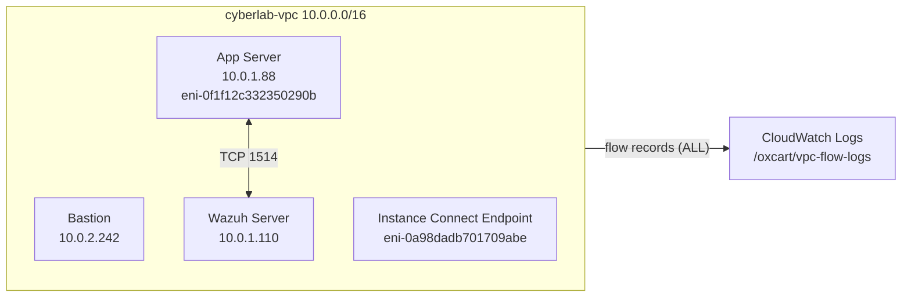

# VPC Flow Logs

| | |
|---|---|
| **Component** | Amazon VPC Flow Logs on `cyberlab-vpc` |
| **Destination** | CloudWatch Logs, log group `/oxcart/vpc-flow-logs` |
| **Traffic filter** | `ALL` (accepted and rejected traffic) |
| **Region** | `ap-southeast-1` (Singapore) |
| **Report date** | 2026-10-27 |
| **Validation status** | Capture verified on the App Server interface |
| **Related** | [Architecture](../README.md), [Suricata IDS](suricata-ids.md), [Infrastructure hardening](infrastructure-hardening.md) |

---

## 1. Overview

OxCart is a cloud cybersecurity lab on AWS. Its monitoring so far has concentrated on specific vantage points: Suricata inspects traffic on the Bastion, Wazuh collects host and application logs, and Nginx records HTTP requests.

This report documents the addition of **VPC Flow Logs**, which record network-level metadata for every network interface in the VPC. They provide a view that none of the other tools has: who talked to whom across the whole VPC, including traffic between private hosts.

## 2. Objective

- Capture connection metadata for all traffic in `cyberlab-vpc`.
- Deliver the records to CloudWatch Logs for search and retention.
- Confirm that records are actually produced, using traffic that is known to exist.
- Define what Flow Logs can and cannot show, and how they fit with the existing tooling.

---

## 3. Architecture and Relevant Addresses

| Item | Value |
|---|---|
| VPC | `cyberlab-vpc` (`vpc-0840b2bb21fa9da1b`), `10.0.0.0/16` |
| Public subnet | `10.0.2.0/24` |
| Private subnet | `10.0.1.0/24` |
| Bastion | `10.0.2.242` |
| App Server | `10.0.1.88`, ENI `eni-0f1f12c332350290b` |
| Wazuh Server | `10.0.1.110` |
| Instance Connect Endpoint | ENI `eni-0a98dadb701709abe` |



Flow Logs are enabled at the VPC level, so every network interface in the VPC is covered, including interfaces created later.

---

## 4. Why VPC Flow Logs

| Reason | Explanation |
|---|---|
| **Visibility between private hosts** | Suricata sits on the Bastion's `ens5` interface, so it only sees traffic that reaches or crosses the Bastion. Traffic between the App Server and the Wazuh Server never passes through it. Flow Logs record that traffic. |
| **Independent of the hosts** | Records are produced by the AWS network layer, not by software on an instance. A compromised or misconfigured host cannot silently disable them. |
| **Accepted and rejected traffic** | With the `ALL` filter, both permitted and denied connections are recorded, which supports investigating probing and misconfiguration. |
| **Investigation timeline** | Per-connection start and end times give a record of which addresses communicated and when. |
| **Future analysis** | Structured, uniform records are a suitable dataset for the planned network anomaly detection work. |

---

## 5. Configuration

| Setting | Value |
|---|---|
| Resource | `cyberlab-vpc` |
| Traffic filter | `ALL` |
| Destination | CloudWatch Logs |
| Log group | `/oxcart/vpc-flow-logs` |
| Maximum aggregation interval | 1 minute |

Custom log format (14 fields):

```text
${version} ${account-id} ${interface-id} ${srcaddr} ${dstaddr} ${srcport} ${dstport} ${protocol} ${packets} ${bytes} ${start} ${end} ${action} ${log-status}
```

The format is a custom one, but its fields correspond to the default version 2 layout.

---

## 6. Validation Methodology

The goal was to prove that records are produced, using traffic that is known to exist rather than traffic generated for the test.

1. **Confirm delivery.** Check that the log group contains a log stream for each network interface.
2. **Pick a known flow.** The Wazuh agent on the App Server connects to the Wazuh manager on TCP 1514, so records for that conversation should exist on the App Server's interface.
3. **Inspect the App Server stream.** Open `eni-0f1f12c332350290b-all` and look for `10.0.1.88` and `10.0.1.110` on port 1514 in both directions.

---

## 7. Evidence and Findings

### 7.1 Log Streams per Interface

The log group contains four log streams. Each is named after a network interface, with an `-all` suffix that matches the `ALL` traffic filter:

| Log stream | Last event time (UTC) |
|---|---|
| `eni-0108d6c426921eb35-all` | 2026-10-27 01:47:31 |
| `eni-085b9dea5ba9790e7-all` | 2026-10-27 01:34:21 |
| `eni-0f1f12c332350290b-all` | 2026-10-27 01:29:01 |
| `eni-0a98dadb701709abe-all` | 2026-10-27 01:27:09 |


Two of these interfaces are identified in this report (the App Server and the Instance Connect Endpoint). The other two are not examined here.

### 7.2 App Server Traffic to and from Wazuh

The `eni-0f1f12c332350290b-all` stream contains records for the Wazuh agent connection between the App Server and the Wazuh Server. Account ID is redacted as `<ACCOUNT_ID>`:

```text
2 <ACCOUNT_ID> eni-0f1f12c332350290b 10.0.1.110 10.0.1.88 1514 35559 6 1 40 1793061426 1793061443 ACCEPT OK
2 <ACCOUNT_ID> eni-0f1f12c332350290b 10.0.1.88 10.0.1.110 35559 1514 6 1 60 1793061426 1793061443 ACCEPT OK
```


What the records show:

- **Both directions are recorded.** The first record is Wazuh (`10.0.1.110`) to the App Server (`10.0.1.88`) from port 1514. The second is the App Server to Wazuh, from ephemeral port 35559 to port 1514.
- **The protocol is TCP** (protocol number 6), and TCP 1514 is the Wazuh agent communication port.
- **Both records were accepted** (`ACCEPT`) and recorded without a reporting issue (`OK`).
- **Both cover the same window:** `1793061426` to `1793061443` (2026-10-27 00:37:06 to 00:37:23 UTC), a 17-second window inside the 1-minute maximum aggregation interval. The 00:37:06 start time matches the CloudWatch event timestamp in the screenshot.
- **The screenshot shows a second connection pair** on ephemeral port 39071 with the same pattern, which is consistent with a separate agent connection.
- **These are normal Wazuh communications**, not an attack.

These records show that the Flow Log is capturing traffic on the App Server's network interface.

### 7.3 Other Traffic on the Same Interface

The same stream also contains records between `10.0.1.88` and public addresses, for example TCP port 443 and UDP port 123 (protocol 17). The port numbers fit outbound HTTPS and time-synchronisation style traffic leaving the private subnet through the Bastion NAT, but ports alone do not identify the application, so this report does not draw further conclusions from them.

### 7.4 Findings

| ID | Observation | Result |
|---|---|---|
| V1 | Log streams exist for four network interfaces in the VPC | Delivery to CloudWatch confirmed |
| V2 | Records for `10.0.1.88` and `10.0.1.110` on TCP 1514, in both directions | Capture on the App Server interface confirmed |
| V3 | Both Wazuh records are `ACCEPT` / `OK` | Traffic accepted and recorded normally |

---

## 8. Anatomy of a Flow Log Record

Using the App Server's outbound record as the example:

```text
2 <ACCOUNT_ID> eni-0f1f12c332350290b 10.0.1.88 10.0.1.110 35559 1514 6 1 60 1793061426 1793061443 ACCEPT OK
```

| # | Field | Example value | Meaning |
|---|---|---|---|
| 1 | `version` | `2` | Flow log record format version |
| 2 | `account-id` | `<ACCOUNT_ID>` | AWS account that owns the interface (redacted) |
| 3 | `interface-id` | `eni-0f1f12c332350290b` | Network interface that observed the traffic (the App Server) |
| 4 | `srcaddr` | `10.0.1.88` | Source address of the traffic |
| 5 | `dstaddr` | `10.0.1.110` | Destination address (the Wazuh Server) |
| 6 | `srcport` | `35559` | Source port (ephemeral client port) |
| 7 | `dstport` | `1514` | Destination port (Wazuh agent communication) |
| 8 | `protocol` | `6` | IANA protocol number: 6 is TCP (17 is UDP, 1 is ICMP) |
| 9 | `packets` | `1` | Packets counted in this record |
| 10 | `bytes` | `60` | Bytes counted in this record |
| 11 | `start` | `1793061426` | Start of the capture window, Unix seconds (2026-10-27 00:37:06 UTC) |
| 12 | `end` | `1793061443` | End of the capture window, Unix seconds (2026-10-27 00:37:23 UTC) |
| 13 | `action` | `ACCEPT` | Traffic was accepted by the applicable AWS network controls (security groups and network ACLs). `REJECT` would mean it was denied |
| 14 | `log-status` | `OK` | Data logged normally. `NODATA` means no traffic in the interval; `SKIPDATA` means some records were skipped |

Each record summarises a flow over a window, not a single packet. A record with `packets` of 1 is a small exchange, not necessarily a whole connection.

---

## 9. Security Value and Limitations

### Security Value

- Provides VPC-wide visibility of connections, including east-west traffic between private hosts.
- Records are generated outside the instances, so they are independent of host-level logging.
- Supports investigating which hosts communicated, over which ports, and when.
- Captures denied (`REJECT`) traffic when it occurs, which is useful for spotting probing.
- Gives a structured dataset for later anomaly detection.

### Limitations

| Limitation | Detail |
|---|---|
| **Metadata only** | Flow Logs record addresses, ports, protocol, counts, and timing. They do not inspect or store packet contents. |
| **Visibility, not prevention** | Flow Logs do not block anything. They are not a firewall or an intrusion prevention system. |
| **`ACCEPT` is not application success** | It means the network controls allowed the traffic. It does not prove that a request completed, that a login worked, or that the service behaved correctly. |
| **Delay** | Records are aggregated over a capture window and delivered afterwards, so they are not a real-time feed. Timing is approximate to the aggregation interval. |
| **Some traffic is not recorded** | AWS excludes certain traffic types, such as instance metadata service requests, DHCP, and queries to the Amazon DNS resolver. |
| **Limited coverage so far** | The records examined show accepted traffic between two private hosts. This does not prove that every possible network path is correctly secured. |

---

## 10. How Flow Logs Complement the Other Controls

Each control sees a different layer. They answer different questions and are most useful together.

| Control | What it sees | Where | Strength | Blind spot |
|---|---|---|---|---|
| **VPC Flow Logs** | Connection metadata: addresses, ports, protocol, volume, `ACCEPT`/`REJECT` | Every network interface in the VPC | VPC-wide, including private-to-private traffic; independent of hosts | No payloads, no application context, delayed |
| **Suricata IDS** | Packet content and HTTP requests, matched against signatures | Bastion `ens5` | Detects known attack patterns such as SQL injection and XSS | Only sees traffic reaching or crossing the Bastion |
| **Wazuh** | Host logs, authentication events, application logs, and alerts from other tools | Agents on hosts, central manager | Correlates and surfaces events in one place | Depends on what hosts log and forward |
| **Nginx access logs** | Each HTTP request: URL, status, user agent | Bastion and App Server | Application-layer request history | Web traffic only |
| **External Nmap scan** | Which ports respond from outside | Bastion public address | Tests the exposed attack surface from an attacker's position | Point-in-time, not continuous |

Used together, the sources cross-check each other. For example, a Suricata alert identifies a suspicious request and its source address, and Flow Logs can show whether that address contacted anything else in the VPC. An Nmap result shows which ports are exposed from outside, while Flow Logs show what actually arrived at the interfaces over time. These are intended workflows, not tests that have been run for this report.

---

## 11. Conclusion

VPC Flow Logs are enabled on `cyberlab-vpc` with the `ALL` filter and deliver to CloudWatch Logs, with one log stream per network interface. Capture was validated on the App Server interface using real Wazuh agent traffic: both directions of the TCP 1514 connection between `10.0.1.88` and `10.0.1.110` were recorded as `ACCEPT OK`.

This closes a visibility gap. Suricata covers traffic through the Bastion and Wazuh covers hosts, but only Flow Logs record connections between private hosts across the VPC.

---

## 12. Evidence Register

| File | Shows |
|---|---|
| `vpc-02-cloudwatch-app-server-traffic.png` | Records for `eni-0f1f12c332350290b` with accepted traffic between the Wazuh Server and App Server |
| `vpc-05-log-streams-per-eni.png` | Log streams, one per network interface, in `/oxcart/vpc-flow-logs` |

---

*Tested in a self-owned lab environment for educational and portfolio purposes. The AWS account ID and account name have been redacted from the screenshots and records.*
